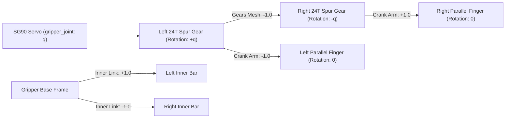
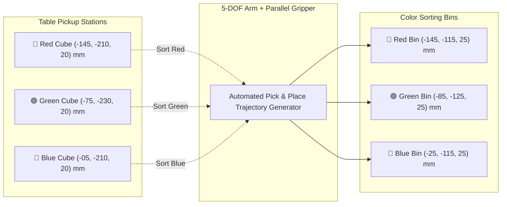
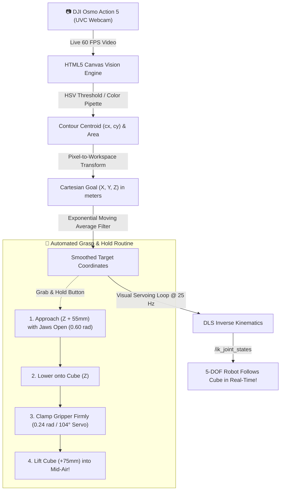
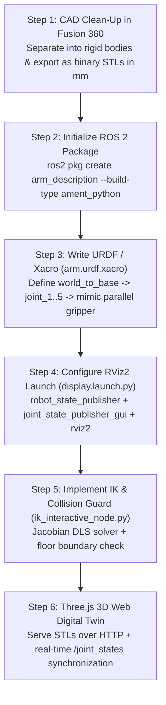

# 🤖 5-DOF Articulated Robotic Arm & Geared 4-Bar Parallel Gripper
## Complete ROS 2 Humble Digital Twin, 3D Web Command Studio & Hardware Control Framework

[](https://docs.ros.org/en/humble/)
[](http://localhost:8080)
[](https://www.arduino.cc/)
[]()

Complete industrial-grade **ROS 2 Humble** Digital Twin package (`arm_description`) for a custom 5-DOF articulated robot arm and 4-bar parallel-jaw gripper designed in **Autodesk Fusion 360**.

This repository contains the full end-to-end stack:
1. **Mathematical Kinematic Model & URDF/Xacro** with physical collision boundaries, inertial tensors, and `<ros2_control>` tags.
2. **Geared 4-Bar Parallel Linkage** mechanism with meshing 24-tooth spur gears and `<mimic>` joints.
3. **Interactive 3D Web Command Center & Digital Twin** served directly at `http://localhost:8080` (Three.js 3D viewer, Multi-Color Cube Sorting, 3D Cartesian IK jogger, and Teach & Replay Studio).
4. **SG90 & MG996R Servo Motor Hardware Studio** with rotating SVG horn dials, 50 Hz PWM microsecond telemetry, and runtime motor type switching.
5. **Real Hardware Serial Bridge & Firmware** for seamless synchronization with physical Arduino / ESP32 servo controllers.

---

## 📑 Table of Contents

1. [Robot Architecture & Specifications](#1-robot-architecture--specifications)
2. [Kinematic Tree & Joint Hierarchy](#2-kinematic-tree--joint-hierarchy)
3. [Package Directory Layout](#3-package-directory-layout)
4. [Link-by-Link CAD Dimensions & Joint Parameters](#4-link-by-link-cad-dimensions--joint-parameters)
5. [Geared 4-Bar Parallel Gripper Linkage Kinematics](#5-geared-4-bar-parallel-gripper-linkage-kinematics)
6. [Inertial Properties & Mass Distribution](#6-inertial-properties--mass-distribution)
7. [Collision Guard & Joint Safety Limits](#7-collision-guard--joint-safety-limits)
8. [Forward & Inverse Kinematics (FK / IK Formulation)](#8-forward--inverse-kinematics-fk--ik-formulation)
9. [Interactive 3D Web Command Center (`http://localhost:8080`)](#9-interactive-3d-web-command-center-httplocalhost8080)
10. [Multi-Color Object Sorting System (Red, Green, Blue)](#10-multi-color-object-sorting-system-red-green-blue)
11. [Vision & Camera Tracking Studio (DJI Osmo Action 5 / USB Webcam)](#11-vision--camera-tracking-studio-dji-osmo-action-5--usb-webcam)
12. [SG90 & MG996R Servo Hardware Studio & PWM Telemetry](#12-sg90--mg996r-servo-hardware-studio--pwm-telemetry)
13. [Hardware Integration & Electrical Wiring Guide](#13-hardware-integration--electrical-wiring-guide)
14. [Zero-Offset Software Calibration (`servo_calibration.json`)](#14-zero-offset-software-calibration-servo_calibrationjson)
15. [Arduino & ESP32 Firmware (`arm_servo_controller.ino`)](#15-arduino--esp32-firmware-arm_servo_controllerino)
16. [How to Build this Virtual Digital Twin from Scratch](#16-how-to-build-this-virtual-digital-twin-from-scratch)
17. [Quick Start & CLI Cheat-Sheet](#17-quick-start--cli-cheat-sheet)

---

## 1. Robot Architecture & Specifications

| Parameter | Specification | Details / Notes |
| :--- | :--- | :--- |
| **Degrees of Freedom** | **5-DOF Arm + 1-DOF Parallel Gripper** (6 Actuated Channels) | Waist Roll, Shoulder Pitch, Elbow Pitch, Wrist Roll, Wrist Pitch, Gripper |
| **Maximum Reach** | **$340\text{ mm}$ (approx. $0.34\text{ m}$)** | From Base Center to Gripper TCP tip |
| **Payload Capacity** | **$250\text{ g} - 350\text{ g}$** | Tested for picking $20\text{ mm}$ acrylic/wood cubes |
| **Lower Joint Servos** | **3x TowerPro MG996R Metal Gear (55g)** | Base `J1`, Shoulder `J2`, Elbow `J3` ($11.0\text{ kg}\cdot\text{cm}$ torque @ 6V) |
| **Upper Joint Servos** | **3x TowerPro SG90 Micro (9g) / MG90S** | Wrist Roll `J4`, Wrist Pitch `J5`, Gripper `G` ($1.8\text{ kg}\cdot\text{cm}$ torque) |
| **Gripper Mechanism** | **4-Bar Parallelogram Linkage + 24T Spur Gears** | Jaws remain strictly parallel across the entire stroke |
| **Gripper Stroke** | **$0.7\text{ mm}$ (Closed) to $38.7\text{ mm}$ (Wide Open)** | No finger collision or overlapping at mechanical zero |
| **Home Position TCP** | **$X = -42.3\text{ mm}, Y = -237.6\text{ mm}, Z = 245.9\text{ mm}$** | Default upright ready pose with all servos at 90° |
| **Operating System** | **Ubuntu 22.04 LTS / ROS 2 Humble Hawksbill** | Tested inside native Linux and WSL2 (WSLg) |
| **Web Server** | **Lightweight Multi-Threaded HTTP Server on Port 8080** | Pure Python standard library, zero external server dependencies |

---

## 2. Kinematic Tree & Joint Hierarchy

The robotic arm follows an open kinematic chain terminating in a closed-loop parallel gripper driven by mimic joints:

```mermaid
flowchart TD
    W["world (Fixed Origin)"] -->|world_to_base [fixed]| B["base_link (Base.stl)"]
    B -->|joint_1 [revolute Z]| S["shoulder_link (Shoulder.stl)"]
    S -->|joint_2 [revolute Z]| E["elbow_link (Elbow.stl)"]
    E -->|joint_3 [revolute Z]| A["arm_link (arm.stl)"]
    A -->|joint_4 [revolute X]| WR["wrist_link (Wrist_.stl)"]
    WR -->|joint_5 [revolute X]| G["gripper_link (gripper_base.stl)"]
    G -->|tcp_joint [fixed]| TCP["tcp_link (Tool Center Point)"]
    
    subgraph Parallel_Gripper_Mechanism ["4-Bar Parallel Linkage & 24T Spur Gears"]
        G -->|gripper_joint [revolute Z - MASTER]| GLG["gripper_left_gear_link (Left 24T Gear)"]
        GLG -->|gripper_left_finger_joint [mimic -1.0]| GLF["gripper_left_finger_link (Left Parallel Jaw)"]
        G -->|gripper_left_inner_joint [mimic +1.0]| GLI["gripper_left_inner_link (Left Coupler Link)"]
        G -->|gripper_right_gear_joint [mimic -1.0]| GRG["gripper_right_gear_link (Right 24T Gear)"]
        GRG -->|gripper_right_finger_joint [mimic +1.0]| GRF["gripper_right_finger_link (Right Parallel Jaw)"]
        G -->|gripper_right_inner_joint [mimic -1.0]| GRI["gripper_right_inner_link (Right Coupler Link)"]
    end
```

---

## 3. Package Directory Layout

```text
/home/vivek/robot_ws/
├── README.md                           # Symlink to src/arm_description/README.md
├── src/
│   └── arm_description/
│       ├── package.xml                 # Package manifest with ROS 2 dependencies
│       ├── CMakeLists.txt              # Build rules, install targets & script symlinks
│       ├── README.md                   # This detailed documentation file
│       ├── config/
│       │   ├── arm.rviz                # Pre-configured RViz2 layout (RobotModel, Markers, Grid)
│       │   ├── servo_calibration.json  # Real-time zero-offset & direction calibration file
│       │   └── saved_waypoints.json    # Disk storage for Teach & Replay poses
│       ├── firmware/
│       │   └── arm_servo_controller/
│       │       └── arm_servo_controller.ino # Arduino Uno / ESP32 6-channel servo firmware
│       ├── launch/
│       │   └── display.launch.py       # Master launch file (RSP, JSP GUI, IK Node, RViz2)
│       ├── meshes/                     # 13 Watertight STL CAD meshes (in millimeters)
│       │   ├── Base.stl
│       │   ├── Shoulder.stl
│       │   ├── Elbow.stl
│       │   ├── arm.stl
│       │   ├── Wrist_.stl
│       │   ├── Gripper v4.stl          # Source CAD model
│       │   ├── gripper_base.stl        # Extracted stationary gripper frame
│       │   ├── gripper_left_gear.stl   # Extracted 24T driving spur gear (Left)
│       │   ├── gripper_left_inner.stl  # Extracted parallel coupler link (Left)
│       │   ├── gripper_left_finger.stl # Extracted parallel jaw finger (Left)
│       │   ├── gripper_right_gear.stl  # Extracted 24T driven spur gear (Right)
│       │   ├── gripper_right_inner.stl # Extracted parallel coupler link (Right)
│       │   ├── gripper_right_finger.stl# Extracted parallel jaw finger (Right)
│       │   └── servo.stl               # Standard servo model (used in 3D Browser Viewer)
│       └── scripts/
│           ├── ik_interactive_node.py  # 3D Web Studio, IK Marker, Sorter & HTTP server
│           └── serial_bridge_node.py   # ROS 2 to Arduino/ESP32 USB Serial bridge
```

---

## 4. Link-by-Link CAD Dimensions & Joint Parameters

All STL meshes were designed in **Autodesk Fusion 360** in millimeters and scaled by `0.001 0.001 0.001` into SI meters in the URDF.

### 4.1 Kinematic Transform Table (Parent to Child Joint Origins)

| Joint Name | Type | Parent $\rightarrow$ Child | Origin `xyz` (m) | Origin `rpy` (rad) | Axis `xyz` | Angle Range (rad) | Servo Range (deg) | CAD Pivot Alignment Notes |
| :--- | :--- | :--- | :--- | :--- | :---: | :---: | :---: | :--- |
| `world_to_base` | `fixed` | `world` $\rightarrow$ `base_link` | `0 0 0` | `0 0 0` | — | — | — | Robot base grounded at origin |
| `joint_1` | `revolute` | `base_link` $\rightarrow$ `shoulder_link` | `-0.10 0 0.07` | `0 0 0` | `0 0 1` | `[-1.57, 1.57]` | `0° .. 180°` | Waist bearing boss center at `(-100, 0, 70) mm` |
| `joint_2` | `revolute` | `shoulder_link` $\rightarrow$ `elbow_link` | `0.00906 -0.01413 0.03490` | `1.5708 0 -1.5708` | `0 0 1` | `[-0.52, 1.31]` | `60° .. 165°` | Shoulder slanted servo output shaft axis |
| `joint_3` | `revolute` | `elbow_link` $\rightarrow$ `arm_link` | `0.1115 0 0` | `3.1416 0 1.5708` | `0 0 1` | `[-1.13, 1.22]` | `25° .. 160°` | Forearm pivot at $111.5\text{ mm}$ along elbow beam |
| `joint_4` | `revolute` | `arm_link` $\rightarrow$ `wrist_link` | `0.1035 -0.008 0.01825` | `3.14159 0 0` | `1 0 0` | `[-1.57, 1.57]` | `0° .. 180°` | Wrist axial roll axis inside forearm casing |
| `joint_5` | `revolute` | `wrist_link` $\rightarrow$ `gripper_link` | `0.021 0 -0.0165` | `3.14159 -1.5708 0` | `1 0 0` | `[-1.05, 1.05]` | `30° .. 150°` | Wrist arch pitch axis driving gripper base |
| `tcp_joint` | `fixed` | `gripper_link` $\rightarrow$ `tcp_link` | `-0.013936 0.120 0.0165` | `0 0 0` | — | — | — | Central grasping point between finger pads |

### 4.2 Mesh Bounding Boxes & Pivot Offsets

For links where the STL coordinate center did not coincide with the mechanical pin axis, an exact compensation offset is specified inside `<visual>` and `<collision>` blocks:

| Link Name | Mesh File | STL Bounding Box (mm) | Visual Origin `xyz` (m) | Visual Origin `rpy` | Physical Role |
| :--- | :--- | :--- | :--- | :---: | :--- |
| `base_link` | `Base.stl` | `[-160..100], [-60..60], [0..70]` | `0 0 0` | `0 0 0` | Heavy desktop mounting base |
| `shoulder_link` | `Shoulder.stl` | `[-50..50], [-50..50], [0..54.4]` | `0 0 0` | `0 0 0` | Turntable with 30° servo bracket |
| `elbow_link` | `Elbow.stl` | `[-20..131.5], [-20..20], [0..20]` | `0 0 0` | `0 0 0` | First structural cantilever link |
| `arm_link` | `arm.stl` | `[-21..100], [-20..20], [0..30]` | `0 0 0` | `0 0 0` | Forearm housing internal micro servo |
| `wrist_link` | `Wrist_.stl` | `[0..50], [-30..0], [0..25]` | `0 0.015 -0.0125` | `0 0 0` | Arched wrist knuckle |
| `gripper_link` | `gripper_base.stl` | `[-31.1..20.4], [-40..62], [-30..3]` | `-0.013936 0.020 0.015` | `0 0 0` | Stationary chassis of the parallel gripper |

---

## 5. Geared 4-Bar Parallel Gripper Linkage Kinematics

The gripper mechanism is an exact **$31.0\text{ mm}$ parallelogram four-bar linkage** coupled across both sides by two interlocking 24-tooth spur gears ($27.0\text{ mm}$ center-to-center pitch distance):

$$\text{Pitch Radius } r_p = 13.5\text{ mm}, \quad \text{Gear Ratio} = 1:1 \quad (\text{Mesh Multiplier } = -1.0)$$



### 5.1 Parallelogram Vector Closure
For either finger, the rotation of the driving gear crank is canceled out identically by the counter-rotation of the finger pivot:

$$\theta_{\text{finger}} = \theta_{\text{gear}} + \theta_{\text{finger\_joint}} = q + (-q) = 0$$

Because $\theta_{\text{finger}} \equiv 0$ for all values of $q$, **the left and right gripper pads remain strictly parallel to each other throughout the entire gripping range.**

### 5.2 Calibrated Jaw Gap vs. Servo Angle Table

| `gripper_joint` Angle ($q$) | Servo Angle (deg) | Inner Jaw Gap (mm) | Physical State & Operational Meaning |
| :---: | :---: | :---: | :--- |
| **`0.00 rad`** | **`90°`** | **`+0.7 mm`** | **Fully Closed (Mechanical Zero)** — Jaws touch cleanly, 0 overlap! |
| `+0.10 rad` | `96°` | `+6.9 mm` | Grasping small objects / thin sheets |
| `+0.20 rad` | `101°` | `+13.0 mm` | Grasping $15\text{ mm}$ cylinders / pens |
| **`+0.24 rad`** | **`104°`** | **`+16.0 mm`** | **Snug Grip for $20\text{ mm}$ Cubes** (Color Sorting routine) |
| `+0.35 rad` | `110°` | `+22.0 mm` | Half-open posture |
| **`+0.60 rad`** | **`124°`** | **`+36.0 mm`** | **Standard Open Gripper Pose** |
| **`+0.65 rad`** | **`127°`** | **`+38.7 mm`** | **Maximum Stroke (Wide Open)** |

---

## 6. Inertial Properties & Mass Distribution

All link volumes were calculated from the watertight CAD meshes using a realistic infill density for 3D-printed PLA ($\rho_{\text{eff}} \approx 350\text{ kg/m}^3$):

$$\text{Mass } m = \rho \int_V dV, \quad \mathbf{c} = \frac{1}{m} \int_V \mathbf{r} \, dm, \quad I_{jk} = \int_V (\delta_{jk} r^2 - r_j r_k) \, dm$$

| Link Name | Mass (kg) | Center of Mass $[X, Y, Z]$ in Link Frame (m) | $I_{xx}\;(\text{kg}\cdot\text{m}^2)$ | $I_{yy}\;(\text{kg}\cdot\text{m}^2)$ | $I_{zz}\;(\text{kg}\cdot\text{m}^2)$ |
| :--- | :---: | :---: | :---: | :---: | :---: |
| `base_link` | `0.1938` | `[-0.01843, 0.00000, 0.01548]` | $3.12 \times 10^{-4}$ | $1.17 \times 10^{-3}$ | $1.32 \times 10^{-3}$ |
| `shoulder_link` | `0.0207` | `[ 0.00500, -0.00254, 0.01039]` | $2.20 \times 10^{-5}$ | $2.20 \times 10^{-5}$ | $3.40 \times 10^{-5}$ |
| `elbow_link` | `0.0196` | `[ 0.05573, 0.00000, 0.00793]` | $3.00 \times 10^{-6}$ | $3.80 \times 10^{-5}$ | $4.00 \times 10^{-5}$ |
| `arm_link` | `0.0216` | `[ 0.04629, 0.00007, 0.01412]` | $5.00 \times 10^{-6}$ | $2.80 \times 10^{-5}$ | $2.90 \times 10^{-5}$ |
| `wrist_link` | `0.0050` | `[ 0.01905, 0.00000, -0.00546]` | $1.00 \times 10^{-6}$ | $1.00 \times 10^{-6}$ | $1.00 \times 10^{-6}$ |
| `gripper_link` | `0.0050` | `[-0.00992, 0.03289, 0.00851]` | $5.00 \times 10^{-6}$ | $2.00 \times 10^{-6}$ | $5.00 \times 10^{-6}$ |
| `gripper_left_gear_link` | `0.0050` | `[ 0.00000, 0.00525, 0.00450]` | $1.00 \times 10^{-6}$ | $1.00 \times 10^{-6}$ | $1.00 \times 10^{-6}$ |
| `gripper_left_finger_link`| `0.0050` | `[ 0.00538, 0.02295, 0.00150]` | $1.00 \times 10^{-6}$ | $1.00 \times 10^{-6}$ | $2.00 \times 10^{-6}$ |
| `gripper_left_inner_link` | `0.0050` | `[ 0.00023, 0.01550, 0.00150]` | $1.00 \times 10^{-6}$ | $1.00 \times 10^{-6}$ | $1.00 \times 10^{-6}$ |
| `gripper_right_gear_link`| `0.0050` | `[ 0.00013, 0.00523, 0.00450]` | $1.00 \times 10^{-6}$ | $1.00 \times 10^{-6}$ | $1.00 \times 10^{-6}$ |
| `gripper_right_finger_link`|`0.0050` | `[-0.00535, 0.02295, 0.00150]` | $1.00 \times 10^{-6}$ | $1.00 \times 10^{-6}$ | $2.00 \times 10^{-6}$ |
| `gripper_right_inner_link`| `0.0050` | `[ 0.00017, 0.01550, 0.00150]` | $1.00 \times 10^{-6}$ | $1.00 \times 10^{-6}$ | $1.00 \times 10^{-6}$ |

---

## 7. Collision Guard & Joint Safety Limits

The software stack enforces a dual-layer safety system:

### 7.1 Hard Joint Angle Limits
Prevents physical self-collision between robot segments:
- **`joint_1` (Base):** `[-1.57, +1.57] rad` $\rightarrow$ Servo `0° .. 180°`.
- **`joint_2` (Shoulder):** `[-0.52, +1.31] rad` $\rightarrow$ Servo `60° .. 165°`. Limits backward travel so the elbow never hits the turntable base.
- **`joint_3` (Elbow):** `[-1.13, +1.22] rad` $\rightarrow$ Servo `25° .. 160°`. Prevents forearm casing from crushing the elbow joint bracket.
- **`joint_4` (Wrist Roll):** `[-1.57, +1.57] rad` $\rightarrow$ Servo `0° .. 180°`.
- **`joint_5` (Wrist Pitch):** `[-1.05, +1.05] rad` $\rightarrow$ Servo `30° .. 150°`. Stops the gripper mounting plate from hitting the wrist arch.
- **`gripper_joint`:** `[0.00, +0.65] rad` $\rightarrow$ Servo `90° .. 127°`. Prevents parallel fingers from colliding or crossing over each other.

### 7.2 Real-Time Table Floor Guard
In `ik_interactive_node.py`, the Forward Kinematics function evaluates the $Z$-coordinate of the wrist and TCP links at 50 Hz.
- If $Z_{\text{wrist}} < 0.025\text{ m}$ ($25\text{ mm}$) or $Z_{\text{tcp}} < 0.010\text{ m}$, the motion command is automatically clamped and the UI badge switches to:
  `⚠️ WARNING: Table Collision Guard (Floor Active)`.

---

## 8. Forward & Inverse Kinematics (FK / IK Formulation)

### 8.1 Forward Kinematics Transformation Chain
For joint vector $\mathbf{q} = [q_1, q_2, q_3, q_4, q_5]^T$, the Tool Center Point pose $T_{\text{world}}^{\text{tcp}}(\mathbf{q})$ is given by:

$$T_{\text{world}}^{\text{tcp}}(\mathbf{q}) = T_{\text{base}}^{1} R_z(q_1) \cdot T_{1}^{2} R_z(q_2) \cdot T_{2}^{3} R_z(q_3) \cdot T_{3}^{4} R_x(q_4) \cdot T_{4}^{5} R_x(q_5) \cdot T_{5}^{\text{tcp}}$$

Where:
- $T_{\text{base}}^{1} = \text{Trans}(-0.10, 0, 0.07)$
- $T_{1}^{2} = \text{Trans}(0.00906, -0.01413, 0.0349) \cdot \text{RPY}(\frac{\pi}{2}, 0, -\frac{\pi}{2})$
- $T_{2}^{3} = \text{Trans}(0.1115, 0, 0) \cdot \text{RPY}(\pi, 0, \frac{\pi}{2})$
- $T_{3}^{4} = \text{Trans}(0.1035, -0.008, 0.01825) \cdot \text{RPY}(\pi, 0, 0)$
- $T_{4}^{5} = \text{Trans}(0.021, 0, -0.0165) \cdot \text{RPY}(\pi, -\frac{\pi}{2}, 0)$
- $T_{5}^{\text{tcp}} = \text{Trans}(-0.013936, 0.120, 0.0165)$

### 8.2 Damped Least-Squares (DLS) Inverse Kinematics
Given target position $\mathbf{x}_{\text{target}} \in \mathbb{R}^3$, the position error is:

$$\mathbf{e} = \mathbf{x}_{\text{target}} - \mathbf{x}(\mathbf{q})$$

The numerical Jacobian $J(\mathbf{q}) \in \mathbb{R}^{3 \times 5}$ is computed via finite differences ($dq = 10^{-4}\text{ rad}$). To avoid singularities near workspace limits, the joint update is solved using Levenberg-Marquardt damping ($\lambda = 0.015$):

$$\Delta \mathbf{q} = J^T \left( J J^T + \lambda^2 I \right)^{-1} \mathbf{e}$$

Iterative updates run with a convergence tolerance $\|\mathbf{e}\| < 1.0\text{ mm}$ (typically converging in 4–8 iterations).

---

## 9. Interactive 3D Web Command Center (`http://localhost:8080`)

The node [`scripts/ik_interactive_node.py`](file:///home/vivek/robot_ws/src/arm_description/scripts/ik_interactive_node.py) hosts a built-in HTTP server on port `8080`.

### Key Capabilities of the Web Dashboard
1. **Three.js 3D Workcell Viewport**: Renders all 12 STL links with smooth lighting, grid, colored cubes, and sorting bins. Left-click to rotate, right-click to pan, scroll to zoom.
2. **Interactive 6-Channel Joint & Gripper Sliders**: Drag any joint to view real-time synchronized motion in the 3D viewer and RViz simultaneously.
3. **3D Cartesian D-Pad & Sliders**: Jog the Gripper TCP by $+15\text{ mm}$ increments along $X, Y, Z$.
4. **Teach & Replay Studio**: Save custom poses with `+ Save`, execute smooth multi-waypoint trajectories with `▶ Play`, or run continuous loops with `🔁 Loop`.
5. **Special Automated Demos**:
   - `⭕ 3D Circle (IK)`: Traces a $110\text{ mm}$ diameter circle in mid-air using real-time inverse kinematics.
   - `👋 Wave Hello`: Natural greeting gesture.
   - `🔍 360° Scan`: Wide inspection sweep across the workspace.
   - `🛑 E-STOP`: Instant abort for any running sequence.

### REST API Endpoints

| HTTP Method | Endpoint | Payload | Description |
| :---: | :--- | :--- | :--- |
| `GET` | `/api/state` | None | Returns joint angles, TCP coordinates, servo degrees, cube positions, and safety state |
| `GET` | `/meshes/<name>.stl` | None | Serves raw binary STL mesh files directly to Three.js |
| `POST` | `/api/joints` | `{"q": [q1..q5], "g": g}` | Sets joint positions directly |
| `POST` | `/api/ik` | `{"x": X, "y": Y, "z": Z}` | Solves IK and drives the arm to Cartesian coordinates |
| `POST` | `/api/jog` | `{"dx": dX, "dy": dY, "dz": dZ}`| Jogs TCP by relative delta |
| `POST` | `/api/speed` | `{"speed": 1.5}` | Adjusts motion speed multiplier ($0.3\times - 2.5\times$) |
| `POST` | `/api/action` | `{"action": "sort_red"}` | Triggers automated routines (`sort_red`, `sort_all`, `estop`, etc.) |
| `POST` | `/api/waypoint` | `{"op": "save" \| "play" \| "clear"}`| Controls Teach & Replay poses |
| `POST` | `/api/vision/track` | `{"x": X, "y": Y, "z": Z}` | Real-time DLS IK visual servoing (moves arm smoothly to tracked cube) |
| `POST` | `/api/vision/grasp` | `{"x": X, "y": Y, "z": Z}` | Approaches cube, opens jaws, grasps firmly (`0.24 rad`), and lifts $+75\text{ mm}$ |
| `POST` | `/api/vision/release` | None | Lowers cube, opens gripper (`0.60 rad`), and returns to Home pose |

---

## 10. Multi-Color Object Sorting System (Red, Green, Blue)

The robot workspace features 3 colored cubes at dedicated pickup pads and 3 matching collection bins:



### Operational Modes
- **`🔴 Sort Red Cube`**: Transits to Red slot, opens gripper, descends, grasps cube, lifts, transports to Red Bin, releases, and returns home.
- **`🟢 Sort Green Cube`**: Executes dedicated sequence for Green cube into Green Bin.
- **`🔵 Sort Blue Cube`**: Executes dedicated sequence for Blue cube into Blue Bin.
- **`🌈 Auto-Sort ALL 3 Cubes (R → G → B)`**: Autonomous multi-cube mission sorting all three cubes in series.
- **`🔄 Reset All 3 Cubes`**: Resets all cubes back to their initial pickup stations.

---

## 11. Vision & Camera Tracking Studio (DJI Osmo Action 5 / USB Webcam)

The system integrates real-time computer vision supporting the **DJI Osmo Action 5** (plugged via USB in UVC Webcam mode) or any standard laptop/USB webcam directly inside the 3D Web Studio (`http://localhost:8080`):



### 11.1 Coordinate Transformation (Camera $\rightarrow$ Robot Base Frame)
Given camera image dimensions $W \times H$ (default $320 \times 240$ on canvas) and detected centroid $(c_x, c_y)$ with bounding box dimension $D = \max(w, h)$:

1. **Horizontal Axis ($Y_{\text{robot}}$ - Waist Sweep):**
   $$u = \left(\frac{c_x}{W} - 0.5\right) \in [-0.5, +0.5] \implies Y_{\text{robot}} = -u \cdot 0.36\text{ m} \quad ([-0.18\text{ m}, +0.18\text{ m}])$$

2. **Vertical Axis ($Z_{\text{robot}}$ - Height):**
   $$v = 1.0 - \frac{c_y}{H} \in [0.0, 1.0] \implies Z_{\text{robot}} = 0.08\text{ m} + v \cdot 0.20\text{ m} \quad ([0.08\text{ m}, 0.28\text{ m}])$$

3. **Depth Axis ($X_{\text{robot}}$ - Forward/Backward Reach):**
   $$\text{frac} = \text{clamp}\left(\frac{D - 25}{115}, 0.0, 1.0\right) \implies X_{\text{robot}} = -0.14\text{ m} - (1.0 - \text{frac}) \cdot 0.12\text{ m} \quad ([-0.26\text{ m}, -0.14\text{ m}])$$

4. **Jitter-Free Exponential Moving Average (EMA) Smoothing:**
   $$\mathbf{x}_{k} = (1 - \alpha)\mathbf{x}_{k-1} + \alpha\,\mathbf{x}_{\text{meas}}, \quad \alpha = 0.22$$

### 11.2 Key Features
- **Plug-and-Play Device Dropdown:** Browser directly enumerates connected devices (`navigator.mediaDevices.enumerateDevices()`). The DJI Osmo Action 5 is auto-selected when plugged in.
- **Color Presets & Interactive Pipette:** Instant buttons for 🔴 Red, 🟢 Green, 🔵 Blue, and 🟡 Yellow. If room lighting varies, simply click anywhere on the real cube in the video feed — the color pipette will instantly sample the exact HSV and lock on!
- **🦾 Live Hand / Cube Following:** Robot smoothly tracks your hand or the cube in mid-air in real-time.
- **🎯 Grab & Hold Routine:** Single-click executes an industrial 4-step pick: approach above $\to$ descend $\to$ clamp at calibrated $0.24\text{ rad}$ ($104°$) $\to$ lift into mid-air.
- **✋ Release & Home:** Opens the jaws and returns smoothly to home pose.
- **Holographic 3D Marker:** A dynamic glowing cyan marker renders in the Three.js viewport in sync with the tracked coordinates.
- **Standalone OpenCV Node:** Also available as a native ROS 2 node at `src/arm_description/scripts/camera_tracking_node.py`.

---

## 12. SG90 & MG996R Servo Hardware Studio & PWM Telemetry

An exclusive feature of the web interface is the **6-Channel Hardware Servo Studio**:

### 11.1 Real-Time 50 Hz PWM Calculation
Standard RC servos operate on a $50\text{ Hz}$ frequency ($20\text{ ms}$ period). The pulse width is computed in microseconds ($\mu\text{s}$):

$$\text{Pulse Width } t_{\text{pulse}} = t_{\min} + \left( \frac{\theta_{\text{deg}}}{180°} \right) \cdot (t_{\max} - t_{\min})$$

$$\text{Duty Cycle } D = \left( \frac{t_{\text{pulse}}}{20\,000\,\mu\text{s}} \right) \times 100\%$$

| Servo Model | Pulse Range ($t_{\min} - t_{\max}$) | Weight | Torque Rating | Recommended Joints |
| :--- | :---: | :---: | :---: | :--- |
| **MG996R (Metal Gear)** | **$500\,\mu\text{s} - 2500\,\mu\text{s}$** | $55\text{ g}$ | $11.0\text{ kg}\cdot\text{cm}$ @ 6V | `J1` Base, `J2` Shoulder, `J3` Elbow |
| **SG90 (Micro Nylon)** | **$500\,\mu\text{s} - 2400\,\mu\text{s}$** | $9\text{ g}$ | $1.8\text{ kg}\cdot\text{cm}$ @ 4.8V | `J4` Wrist Roll, `J5` Wrist Pitch, `G` Gripper |

### 12.2 Live Features
- **Dynamic 3D Mesh Updates**: Changing any channel's dropdown between `MG996R` and `SG90` dynamically changes the 3D motor mesh in the browser (metallic black vs. royal blue) and updates the torque specifications in real time.
- **Rotating Horn Gauges**: Responsive SVG dials show the physical orientation of each servo horn in degrees ($0° - 180°$).
- **Direct Degree Trimmers**: Step buttons (`-5°`, `90° Center`, `+5°`) allow micro-adjusting individual servos directly from the browser.

---

## 13. Hardware Integration & Electrical Wiring Guide

### 13.1 Wiring Pinout Table

| Servo Channel | Robot Joint | Arduino Uno / Nano PWM Pin | ESP32 GPIO Pin | Wire Color Code | Power Source |
| :---: | :--- | :---: | :---: | :---: | :--- |
| **S1** | `joint_1` (Base Waist) | **Pin 3** | **GPIO 13** | Orange / Yellow (Signal) | External 5V/6V (+) |
| **S2** | `joint_2` (Shoulder Pitch) | **Pin 5** | **GPIO 12** | Orange / Yellow (Signal) | External 5V/6V (+) |
| **S3** | `joint_3` (Elbow Pitch) | **Pin 6** | **GPIO 14** | Orange / Yellow (Signal) | External 5V/6V (+) |
| **S4** | `joint_4` (Wrist Roll) | **Pin 9** | **GPIO 27** | Orange / Yellow (Signal) | External 5V/6V (+) |
| **S5** | `joint_5` (Wrist Pitch) | **Pin 10** | **GPIO 26** | Orange / Yellow (Signal) | External 5V/6V (+) |
| **S6** | `gripper_joint` (Parallel Gripper)| **Pin 11** | **GPIO 25** | Orange / Yellow (Signal) | External 5V/6V (+) |

> [!CAUTION]
> **CRITICAL POWER SUPPLY RULES:**
> 1. **NEVER power the 6 servos from the Arduino's 5V pin!** Six servos during motion draw between $2.5\text{A}$ and $5.0\text{A}$. Attempting to power them from the Arduino board will immediately overheat the onboard voltage regulator and cause continuous brownout resets.
> 2. **ALWAYS connect a Common Ground:** Connect the Negative/Ground (`-`) wire of the external $5\text{V}/6\text{V}$ power supply directly to an **Arduino `GND`** pin. Without a shared common reference ground, PWM signal voltage floats and servos will jitter uncontrollably.

---

## 14. Zero-Offset Software Calibration (`servo_calibration.json`)

Mechanical spline alignment on servo horns rarely lands exactly on true 90°. Instead of disassembling screws, calibrate electronically via [`config/servo_calibration.json`](file:///home/vivek/robot_ws/src/arm_description/config/servo_calibration.json):

```json
{
  "home_offsets_deg": [0, 0, 0, 0, 0, 0],
  "directions": [1, 1, 1, 1, 1, 1],
  "min_deg": [0, 60, 25, 0, 30, 90],
  "max_deg": [180, 165, 160, 180, 150, 127]
}
```

The node [`serial_bridge_node.py`](file:///home/vivek/robot_ws/src/arm_description/scripts/serial_bridge_node.py) monitors this JSON file every 2 seconds. When you edit and save changes, it reloads them live without stopping the launch!

---

## 15. Arduino & ESP32 Firmware (`arm_servo_controller.ino`)

The firmware is located at [`firmware/arm_servo_controller/arm_servo_controller.ino`](file:///home/vivek/robot_ws/src/arm_description/firmware/arm_servo_controller/arm_servo_controller.ino).

### Protocol Specification
Commands are sent over USB Serial at **$115\,200\text{ baud}$** in comma-separated ASCII ending with newline `\n`:

```text
<S1>,<S2>,<S3>,<S4>,<S5>,<S6>\n
Example (All Servos at Center 90°): 90,90,90,90,90,90\n
```

### Safety Features in Firmware
1. **Power-On Soft Homing**: Initializes all channels safely to $90°$ on startup.
2. **Hardware Value Clamping**: Every incoming degree token is bounded by `constrain(val, MIN_DEG[i], MAX_DEG[i])` before driving the servo.
3. **Smooth Motion Slew-Rate Limiter**: Target angles are smoothly interpolated at $50\text{ Hz}$ to prevent sudden high-current surges that can damage 3D-printed teeth.

---

## 16. How to Build this Virtual Digital Twin from Scratch

If creating a new robot or rebuilding this package from scratch, follow this exact workflow:



---

## 17. Quick Start & CLI Cheat-Sheet

### 17.1 Build the Package
```bash
cd /home/vivek/robot_ws
source /opt/ros/humble/setup.bash
colcon build --symlink-install
source install/setup.bash
```

### 16.2 Launch Master System (RViz + Web Command Center + Serial Bridge)
```bash
source /home/vivek/robot_ws/install/setup.bash
ros2 launch arm_description display.launch.py
```

### 16.3 Access the Web Dashboard
Open any browser on your machine or local network:
👉 **[http://localhost:8080](http://localhost:8080)**

### 16.4 Verify Active Topics
```bash
# List all active ROS 2 topics
ros2 topic list

# Echo live joint angles
ros2 topic echo /joint_states

# Echo Tool Center Point goal updates
ros2 topic echo /arm_ik_marker/update
```

---

## 📄 License & Attribution
- Designed by **Vivek** in Autodesk Fusion 360.
- Implemented as a complete ROS 2 Humble Digital Twin with interactive Three.js Web 3D control and Arduino/ESP32 serial synchronization.
